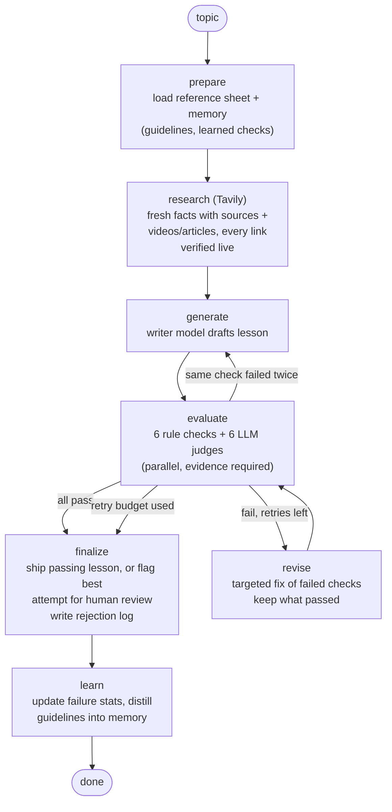

# Self-Evaluating Lesson Generator

An agentic system that **researches the topic on the web, writes a beginner lesson with verified links and videos, grades it against a hard pass/fail rubric, and rewrites it until it clears the bar**. Nothing reaches a human until the system has decided on its own that the lesson is good enough to ship. It also **learns across runs**: checks that keep failing become guidelines in the writer's prompt, and human feedback can add new rubric checks.

- **Topic for submission:** Introduction to RAG (Retrieval-Augmented Generation). The system itself is **topic-general**: `--topic` takes any topic, and nothing in the template, rubric or tests is specific to RAG (see decision 0).
- **Learner:** a class-12 graduate in India from a non-English-medium school, with limited English vocabulary and no coding background, who wants to start an AI career.
- **Stack:** Python, LangGraph (orchestration), Pydantic structured outputs, JSON-file memory. **Works with any chat model**: Claude, Gemini/Gemma, or anything behind an OpenAI-compatible API (OpenAI, OpenRouter, Groq, Together, DeepSeek, Ollama, LM Studio, vLLM). The writer and the judge can come from different providers. Current config: `gemini-3.1-flash-lite` (Gemini free tier); earlier runs in `runs/` used `gemini-3.5-flash-lite`.
- **Internet access:** Tavily web search for fresh facts and learning resources; every link is verified live before it can appear in a lesson.

---

## Setup (about 5 minutes)

**You need:** Python 3.10 or newer, git, and two free API keys:
- a **Gemini API key** from [Google AI Studio](https://aistudio.google.com/apikey) (free tier is enough), and
- a **Tavily API key** from [tavily.com](https://tavily.com) (free tier; optional, but needed for web research and verified links).

Any other provider works too (Claude, OpenAI, OpenRouter, Groq, Ollama...); see *Choosing models* below.

**1. Clone and install**

```bash
git clone https://github.com/Swachhith/GenAI_ed_system.git
cd GenAI_ed_system
python -m venv .venv
.venv\Scripts\activate            # macOS/Linux: source .venv/bin/activate
pip install -r requirements.txt
```

**2. Add your keys**

```bash
copy .env.example .env            # macOS/Linux: cp .env.example .env
```

Open `.env` and set (replace the example lines at the top):

```ini
LLM_PROVIDER=gemini
GEMINI_API_KEY=your-gemini-key
GENERATOR_MODEL=gemini-3.1-flash-lite
EVALUATOR_MODEL=gemini-3.1-flash-lite
EVAL_CONCURRENCY=2                 # free tier allows ~15 requests/minute
TAVILY_API_KEY=your-tavily-key     # optional: web research + verified videos/articles
```

`.env` is gitignored, so your keys never get committed.

**3. Check the install (no API calls, ~5 seconds)**

```bash
python -m pytest -q                # expect: 45 passed
```

**4. Run it**

```bash
python -m lesson_agent run --topic "Introduction to RAG"          # the full loop (3-6 min on the free tier)
python -m lesson_agent run --topic "Introduction to RAG" --inject factual   # plant a deliberate error, watch it get caught
python -m lesson_agent run --topic "Introduction to Embeddings"   # any topic works (reference sheet drafted from the web)
python -m lesson_agent evaluate output/final_lesson.md            # grade any lesson file, no regeneration
python -m lesson_agent research --topic "Introduction to RAG"     # web step only: fresh facts + live-verified links
python -m lesson_agent memory show                                # what the system has learned so far
```

On the free tier you will see lines like `(Gemini 429: waiting 20s before retrying)`. That is the rate limit, handled automatically; the run continues.

**Troubleshooting**
- `LLM_PROVIDER must be one of ...`: check the spelling in `.env`.
- `Set GENERATOR_MODEL ...`: the `openai` provider has no default model; set both model names.
- Many 429 waits: lower `EVAL_CONCURRENCY` to 1, or use a paid key.
- No `Learn more` links in the lesson: `TAVILY_API_KEY` is missing or the network is blocked; the system falls back to the curated links for curated topics, and leaves links out otherwise.

Outputs land in `runs/<run_id>/` (every draft, every evaluation, diffs). Stable copies of the latest result go in `output/`:

| File | What it is |
|---|---|
| `output/final_lesson.md` | The lesson that passed every check. If nothing passed, you get `best_attempt_NEEDS_REVIEW.md` instead, and it is **not** shipped. |
| `output/rejection_log.md` | What failed, why (quoted evidence), what changed on each retry, and what the system learned. |
| `output/rejection_log.json` | The same log as machine-readable data, including every judge's reasoning. |

### Sample runs included in `runs/`

| Run | What it shows |
|---|---|
| `20261021-124305` | First live run, with the original holistic judges: passed 11/11 but too leniently. This run motivated the itemized verdicts |
| `20261021-124547` | Jargon judge plus pre-screen catches unexplained "model weights"; targeted revision fixes it |
| `20261021-124748` | **Deliberate error demo** (`--inject factual`): caught by L1_ACCURACY, fixed; the fix introduced a long sentence, which was caught and fixed on attempt 3 |
| `20261021-124859` | Repeated R2 failure → learner writes guideline **G1** into memory |
| `20261021-125136` | G1 now in the writer's prompt (no R2 failure); repeated L4 failure → guideline **G2** |
| `20261021-125344` | Final lesson (`output/final_lesson.md`); G1/G2 reinforced, G3 learned |
| `calibration-20261021-153301` | Rubric calibration **before** the hardening below: 5/7 planted defects caught, 1 false alarm, 8 spillover |
| `calibration-20261021-154802` | Rubric calibration **after**: 7/7 caught, 0 false alarms, 2 spillover (also in `output/calibration.md`) |
| `20261022-082834` | Web research + verified links added. Sentence-length and jargon fixes undid each other; retry budget used, **correctly not shipped**. Led to the "explain a term in its own short sentence" rule |
| `20261022-083015` | Earlier passing lesson: accuracy + sentence failures fixed in one targeted revision, 12/12; verified IBM video, articles and a Hindi video in *Learn more*; guideline **G4** learned |
| `20261022-085459` | **Any topic:** "Introduction to Embeddings", no curated sheet, so the reference sheet was drafted from web search; 8 verified videos; full write, evaluate, revise loop; retry budget used, so held for human review |
| `20261022-102658` | **Current final lesson** (`output/final_lesson.md`): draft → targeted revision → fresh rewrite after L3 failed twice → **12/12**. Run after fixing three false failures in the evaluator (quote-ending sentences, label-based step matching, 'chunking' vs 'chunk') |

### Choosing models (any provider)

Set the provider and models in `.env`. A `provider:` prefix sends one role to a different provider:

```ini
# one provider for both roles
LLM_PROVIDER=gemini
GENERATOR_MODEL=gemini-3.1-flash-lite
EVALUATOR_MODEL=gemini-3.1-flash-lite

# any OpenAI-compatible endpoint (OpenAI, OpenRouter, Groq, Ollama, vLLM, ...)
LLM_PROVIDER=openai
OPENAI_BASE_URL=http://localhost:11434/v1     # e.g. Ollama; omit for api.openai.com
OPENAI_API_KEY=ollama
GENERATOR_MODEL=llama3.1:8b
EVALUATOR_MODEL=qwen2.5:14b

# mix: a cheap model writes, a stronger one from another provider judges
GENERATOR_MODEL=gemini:gemini-3.1-flash-lite
EVALUATOR_MODEL=anthropic:claude-opus-5-5
JUDGE_VOTES=3        # optional: 3 independent judge samples, majority per item (steadies small judges)
```

Models without native structured output (or that reject JSON mode or system prompts, such as Gemma) still work. The provider layer falls back to JSON in plain text, validates it against the Pydantic schema, and sends the validation error back once for a repair. **After switching the judge model, run `calibrate`** to see how well that model actually enforces the rubric.

### All commands

```bash
python -m lesson_agent run [--topic "..."] [--inject MODE] [--max-retries N]
python -m lesson_agent evaluate path/to/lesson.md      # grade any lesson file, no regeneration
python -m lesson_agent research [--topic "..."]          # web research only
python -m lesson_agent calibrate [--topic "..."] [--lesson FILE] [--modes factual,idiom]   # recall / false alarms of the rubric
python -m lesson_agent feedback "Learners didn't know the word 'leverage'"             # adds a writing guideline
python -m lesson_agent feedback "Every analogy must say where it breaks" --as-check    # adds a rubric check
python -m lesson_agent memory show | reset
python -m lesson_agent graph                           # prints the agent graph as Mermaid
```

---

## Architecture



| Module | Responsibility |
|---|---|
| `lesson_agent/graph.py` | LangGraph state machine: nodes, routing, the retry bound |
| `lesson_agent/rubric.py` | The rubric: 12 core checks + any checks learned from feedback |
| `lesson_agent/web.py` | Web research: Tavily search, fresh facts tied to sources, live link verification (YouTube oEmbed / page fetch), daily cache |
| `lesson_agent/rules.py` | Deterministic checks (readability, sentence length, structure, length, quiz) |
| `lesson_agent/evaluator.py` | Runs the rubric: rule checks locally, LLM judges in parallel |
| `lesson_agent/prompts.py` | All prompts: writer, reviser, judge, learner |
| `lesson_agent/knowledge.py` + `knowledge/*.json` | Reference sheets, the only place topic knowledge lives: curated (`rag.json`) or drafted from web search for any other topic |
| `lesson_agent/memory.py` | Persistent memory: run history, per-check stats, failure evidence, guidelines, learned checks |
| `lesson_agent/learner.py` | Self-evolution: failures become guidelines, feedback becomes checks |
| `lesson_agent/inject.py` | Deliberate error injection: 8 defect types, each built from the topic's reference sheet (factual, subtle, overclaim, jargon, idiom, long-sentence, fake-link, missing-limits) |
| `lesson_agent/calibrate.py` | Tests the evaluator: plants each defect into a known-good lesson, reports recall, false alarms and spillover |
| `lesson_agent/report.py` | Writes the lesson and the rejection log |
| `lesson_agent/llm.py` | Provider layer (Claude, Gemini, any OpenAI-compatible API, per-role routing) with two methods: `text()` and `structured()` |

---

## The rubric: 12 hard gates, no partial credit

The lesson ships only if **every** check passes. There is no weighted score. A weighted average would let a lesson with a factual error pass on the strength of nice formatting. Here, any failed check is a rejection.

| ID | Dimension | Kind | PASS means |
|---|---|---|---|
| R1_STRUCTURE | coherent flow | rule | H2 sections for the prerequisite, what, why, how, example, limits, recap, quiz, key words |
| R2_SENTENCES | beginner language | rule | average ≤ 15 words per sentence and no sentence > 25 words |
| R3_READABILITY | beginner language | rule | Flesch Reading Ease ≥ 60 (plain English) |
| R4_LENGTH | covers key points | rule | 850–1800 words (one sitting for a slow reader) |
| R5_QUIZ | teaches by example | rule | ≥ 3 self-check questions with answers |
| R6_RESOURCES | teaches by example | rule | a 'Learn more' section with 2–4 links, at least one video, and **every** URL in the lesson is on the list verified live during research (no invented links) |
| L1_ACCURACY | accurate & grounded | LLM | **every** claim sentence (extracted by code, checked one by one) agrees with the reference sheet; no overclaim; no listed misconception stated or implied |
| L2_COVERAGE | covers key points | LLM | every must-cover point on the topic's reference sheet is actually taught |
| L3_JARGON | no unexplained jargon | LLM | every technical term explained at or before its first use (a glossary alone doesn't count) |
| L4_EXAMPLES | teaches by example | LLM | an Indian everyday analogy mapped correctly, plus one concrete case walked through every step of "How does it work?" |
| L5_LEARNER_FIT | beginner language | LLM | common words, no idioms or slang, no assumed coding or AI knowledge, encouraging tone |
| L6_FLOW | coherent flow | LLM | ideas introduced before use; what → why → how → example → limits → recap; no re-glossing the same term over and over |
| H*_… | (learned) | LLM | added at run time from human feedback via `feedback --as-check` |

---

## Design decisions and trade-offs

**0. Topic-general by construction.**
The code knows only two things: the *audience* (the learner profile) and *good teaching* (the template, the rubric, the defect types). Everything about a *topic* lives in its reference sheet: short name, prerequisite idea, must-cover points, facts, misconceptions, jargon, and resources. A topic with a curated sheet (`knowledge/*.json`, matched on whole words, so "Paragraphs" doesn't match "rag") uses it. Any other topic gets a sheet drafted from web search results, cached, and labelled `trust: generated+web`. The rubric reads its items from the sheet: L1 from the misconceptions, L2 from the must-cover points, L3 from the jargon, and R6 from the verified resources. The defect injections are built from the sheet too (the topic's own top misconception, its own unexplained terms). A guard test fails if a topic word ever appears in the shared prompts, rubric or judge items. Every lesson-level test runs for two different topics.

**1. Hybrid evaluator: rules where possible, judges only where necessary.**
Sentence length, readability, structure, length and quiz presence are measurable, so plain Python checks them. These checks are free, deterministic, and the writer model can't argue its way past them. LLM judges are used only for what needs judgment: accuracy, jargon, examples, learner fit, and flow. *Trade-off:* Flesch is a blunt proxy for "easy English" (it counts syllables, not word familiarity). L5_LEARNER_FIT covers vocabulary and idioms on top of it.

**2. One narrow judge per check, not one "grade everything" call.**
Each judge answers a single yes/no question, so verdicts don't bleed into each other and every rejection traces to one criterion. The judges run in parallel. *Trade-off:* about 6 calls per evaluation instead of 1, which means more tokens. I chose traceability and reliability over cost. `EVAL_CONCURRENCY` controls rate-limit pressure.

**3. Itemized, evidence-anchored verdicts, decided in code.**
Each LLM check is broken into concrete items: every misconception (L1), every must-cover point (L2), every detected technical term (L3), each part of the example (L4), and so on. The judge must mark each item met or unmet *with a quote*, and **the verdict is computed in code**: any unmet item is a FAIL, whatever the judge's overall opinion. This was the single biggest quality fix (see *What the live runs taught me* below). The quotes also give the reviser exact locations to change and make the rejection log auditable. A judge that errors out counts as a FAIL (fail closed): a broken evaluator must never let content through.

**3b. Rule-based pre-screen feeding the jargon judge.**
`rules.undefined_at_first_use` finds each technical term's first use and checks whether a definition cue attaches to the term in that sentence or the next few ("chunk (…)", "called a chunk", "a chunk is…"). Terms with no cue are handed to the judge as *suspects*, and the judge must quote an explanation to clear them. The heuristic alone is too noisy to be a verdict, and the judge alone was too lenient. Together they work.

**3c. The judge is treated as an unreliable witness, whatever model it is.**
Small and open models skip items, invent quotes, and wave things through. So the evaluator checks the judge, in code:
- *Every item must be answered.* Skipped items are asked again once, then count as unmet (fail closed).
- *Quotes are verified against the lesson* (`rules.grounded`, tolerant of formatting and "..." elisions). Items that need proof (coverage, jargon, examples) pass only with a quote that really is in the lesson. An extra problem the judge raises only counts if its quote is really in the lesson, so a hallucinated complaint can't trigger a pointless rewrite.
- *Accuracy is checked claim by claim.* Code extracts every sentence that says something about the topic (about 80 in a lesson) and the judge rules on each one. Sentences with absolute wording ("always", "stops", "completely", "guarantees") are flagged as suspects, because that is where beginner lessons overclaim. Long item lists are split into batches of 40 so a small model doesn't skim the tail.
- *Over-explaining is measured.* Terms re-defined more than twice are handed to the flow judge as suspects. This came from a live run where a learned guideline caused exactly that.
- *Optional voting* (`JUDGE_VOTES=3`): independent samples, majority per item, ties fail.

**3d. The rubric is tested, not trusted.** `calibrate --topic T` plants eight known defects into a known-good lesson, each **built from that topic's reference sheet**: its top misconception stated confidently, another misconception slipped into the example, an overclaim, the topic's own technical terms left unexplained, idioms, a 40-word formal sentence, an invented video link, and a deleted section. It reports which ones the owning check caught (recall), whether the clean lesson passes (false alarms), and which unrelated checks fired (spillover). This is how a judge model is qualified before use, and how a prompt or threshold change is shown to help rather than assumed to.

**3e. Internet access, without trusting the internet blindly.**
With `TAVILY_API_KEY` set, a `research` node runs before writing. (1) *Fresh facts:* recent search results are distilled into a few beginner-level facts, each tied to the URL it came from. Facts citing a URL that wasn't in the results are dropped. They go into the reference sheet as `fresh_facts_from_the_web`, below the curated facts in trust, and the accuracy judge sees them too. (2) *Links and videos:* candidates come from the curated sheet plus YouTube and article searches, including a Hindi-explainer search for this learner. **Every link is checked live** before the writer sees it: YouTube through oEmbed (which returns 404 for removed or made-up videos), other pages by fetching them. The writer may only use links from that list, and rule **R6** rejects any URL in the lesson that isn't on it. Models invent plausible YouTube links; this makes that impossible to ship. Research is cached per topic per day (`knowledge/web/`), listed in the rejection log, and best-effort: with no key or no network, the system falls back to the curated sheet.

**4. Grounding against a curated reference sheet.**
"Accurate" means *consistent with a source we control* (`knowledge/rag.json`: facts, nine must-cover points, seven common misconceptions), not "whatever the judge model happens to believe". The misconception list is what lets the accuracy judge reliably catch the most likely errors, such as "RAG retrains the model". For topics without a curated sheet, the model drafts one from web search results (or its own knowledge when offline), caches it, and labels it `trust: generated+web` (or `generated`) in the log.

**5. Separate writer and judge models.**
By default Sonnet 5.5 writes and Opus 5.5 judges, at higher effort. A model grading its own output tends to favour it, so a different (and stronger) judge reduces self-preference bias. The judge prompt also states that it did not write the lesson.

**6. Targeted revision first, fresh rewrite on repeated failure.**
On failure, the reviser gets the failed checks with their evidence and fixes, plus the list of checks that passed and must not regress. It edits instead of rewriting, so good parts survive. **After any revision, all checks run again**, so a fix that breaks something else is caught. If the *same* check fails twice in a row, targeted edits aren't working, so the router escalates to a full rewrite with that failure given as an explicit constraint.

**7. Guaranteed termination.**
`MAX_RETRIES` (default 2, capped at 3) is enforced in one routing function, with a LangGraph recursion limit as a backstop. If the budget runs out, the system does **not** ship. It saves the best attempt (most checks passed) as `best_attempt_NEEDS_REVIEW.md` and reports the remaining failures.

**8. Why LangGraph.**
The loop is a real state machine with three exits from `evaluate`. A graph keeps routing explicit and separately testable, and each node reads and writes a typed state, which is what gets logged. A hand-written while-loop would hide those decisions.

### Memory and self-evolution

`memory/memory.json` persists across runs. It holds run history, per-check `evaluated`/`failed` counts, recent failure evidence per check, guidelines, and learned checks.

- **Learning from logs:** after each run, every check that has failed at least `LEARN_MIN_FAILURES` times (default 2, across all runs) is sent to a learner prompt together with its recent evidence. The learner writes one general, preventive guideline (for example, "Explain each technical term in brackets the first time it appears"), or reports that an existing guideline already covers it, in which case that guideline is reinforced. Guidelines are injected into every later generate and revise prompt, so first drafts improve over time. They are capped at 10, and the least-used learned ones are retired to keep the prompt short.
- **Learning from human feedback:** `feedback "..."` adds a human guideline. `feedback "..." --as-check` turns the comment into a **new rubric check** that the evaluator runs from then on, so the rubric itself grows when a human spots something it missed.
- *Why a JSON file and not a vector DB:* the memory is small and structured, and the point is that a reviewer can read it, diff it, and reset it. Retrieval over it would add complexity without adding capability at this scale.

### What the live runs taught me (evaluator hardening)

The submission runs used `gemini-3.5-flash-lite` (Gemini free tier) as both writer and judge. Reading every output by hand exposed weaknesses in the evaluator itself. Each one led to a design change:

| Observed in a live run | Root cause | Change |
|---|---|---|
| Run 1 passed 11/11, but "model weights" was never explained and the example skipped document preparation | A holistic PASS/FAIL from a small judge is lenient | Itemized verdicts computed in code (decision 3). The same lesson, re-evaluated: correctly **rejected** on L4 |
| Judge still waved "weights" through | Judge didn't really check each term | Rule-based pre-screen that hands the judge concrete suspects (3b). Now caught in the very next run, and fixed by revision |
| A planted false claim also failed L2/L5/L6 | Judges reported problems outside their own scope, which blurred attribution | Scope instruction in the prompt; L2's verdict uses only its listed must-cover items |
| L6 failed a lesson for putting the LLM section before "What is RAG" | Judge item contradicted the required template | Item now states the planned order explicitly |
| A lesson of 758 words passed although the writer is asked for 900–1400 | Rubric was looser than its own spec | `word_count_min` raised to 850 |
| Crash: `429 RESOURCE_EXHAUSTED` (15 requests/min free tier; a run makes ~20+ calls) | No backoff | Retry that honours Google's `retryDelay`, plus `EVAL_CONCURRENCY=2` |
| A fix for one check broke another (a revision introduced a 27-word sentence) | Expected behaviour | Already handled: **every** check re-runs after **every** revision. The regression was caught and fixed on attempt 3 |
| The shipped lesson said the method "stops the AI from making up false answers", and the judge passed it | One "check every other claim" item let a small judge skim | Claim-by-claim L1 with absolute-wording suspects (3c). Re-evaluated, that same lesson is now **rejected** on exactly that sentence |
| First calibration: 5/7 caught, false alarm on the clean lesson, 8 spillover failures | (a) my quote matcher rejected genuine quotes containing 'nested quotes'; (b) the over-glossing pre-check flagged normal teaching (a term defined 3 times) and counted chunk/chunks twice; (c) the accuracy judge marked true-but-unreferenced sentences as false; (d) the "subtle overclaim" slipped past | (a) matcher fixed, with a regression test; (b) threshold 4+, word variants merged; (c) "a true claim the reference doesn't mention is fine; judge truth only"; (d) each absolute claim is asked point-blank with its trigger word. Second calibration: **7/7, 0 false alarms, 2 spillover** |
| While tuning, I had put the literal phrases from the known flaws into the judge prompts as examples | That is test leakage: it would inflate the catch rate | Removed. The final numbers above come from prompts with generic wording only. With the leak removed, the grammar slip "is called hallucinate" is **no longer caught**, so it's listed as a limitation |

### Known limitations

- **Calibration status.** Full calibration: 7/7 planted defects caught with 0 false alarms (`gemini-3.5-flash-lite`). After the topic-general refactor, a partial re-run with the new topic-built defects caught every defect it reached (5/5); one false alarm on the clean lesson (a jargon flag) remains open. Re-running `calibrate` after any model or prompt change is part of the workflow.

- LLM judges can still be wrong. Evidence quoting makes that visible in the log, and `calibrate` measures it, but it doesn't make the judges infallible. With `gemini-3.5-flash-lite` as the judge, the hardened rubric now rejects the old shipped lesson's overclaim, but still misses its grammar slip ("is called **hallucinate**") and "AI models usually forget private or new facts". A stronger judge (one line in `.env`, any provider) or `JUDGE_VOTES=3` is the fix.
- Judges vary from run to run: the same lesson failed L2 on one evaluation and passed it on another. `JUDGE_VOTES=3` (majority per item) reduces this at 3x the judge cost.
- The calibration set is small (7 defects, one clean lesson) and I tuned the rubric against it, so 7/7 is a ceiling, not a guarantee. The defects were written before tuning and not changed to fit (one expectation was relaxed, with the reason in `inject.py`: deleting the limits section leaves M8 covered by the recap). A held-out set of defects is the next step.
- In the submission runs, writer and judge are the same small model (free-tier constraint), which weakens decision 5.
- Learned guidelines can over-correct. The jargon guideline made one draft re-define the same term several times.
- Learned guidelines are not A/B tested yet. A natural next step is to track first-draft pass rate before and after each guideline and retire ones that don't help.
- The readability thresholds are tuned for this audience and this topic. Other audiences would need different numbers.

---

## Testing

`python -m pytest -q` runs offline. A scripted fake LLM drives the **real** graph, rules, memory, and reports. **Every lesson-level test runs once per topic** in `tests/fixtures/topics/` (RAG, and large language models as a second, different subject), so a test can only pass if the code is topic-general. The tests check that:
- no topic's words appear in the shared prompts, rubric criteria or judge items (guard test); topic matching uses whole words; an uncurated topic gets a generated reference sheet;
- a clean draft ships first time;
- a planted factual error is caught by L1_ACCURACY, fixed by targeted revision, and recorded in the rejection log;
- a check that never passes escalates generate → revise → regenerate, stops at the retry budget, and is **not** shipped;
- a repeated failure produces a guideline that is persisted and appears in the next run's prompt;
- human feedback adds a rubric check;
- the evaluator survives badly behaved judges: skipped items are re-asked and then fail closed; "passes" backed by invented quotes don't count; invented complaints are dropped while real ones count; votes take the majority;
- every sentence is sent to the accuracy judge, absolute wording is flagged, and quote matching tolerates formatting but not invention;
- the provider layer extracts JSON from chatty replies and repairs invalid JSON once; `provider:model` routing works; calibration reports recall and false alarms.

`python -m lesson_agent calibrate` is the live counterpart: it measures how well the configured judge model actually enforces the rubric.
